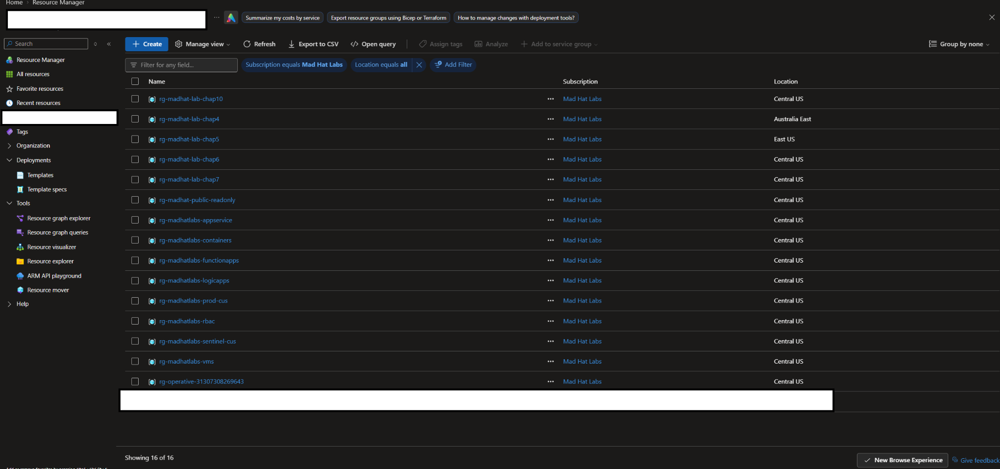
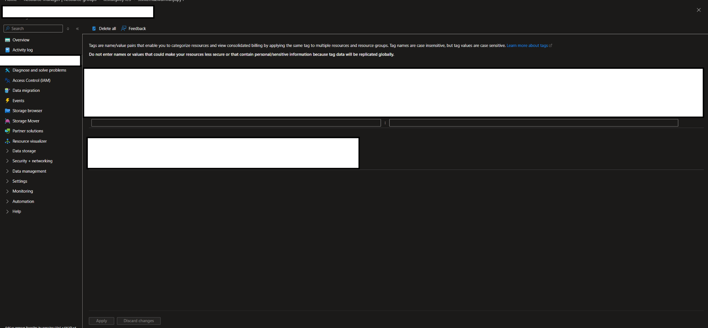
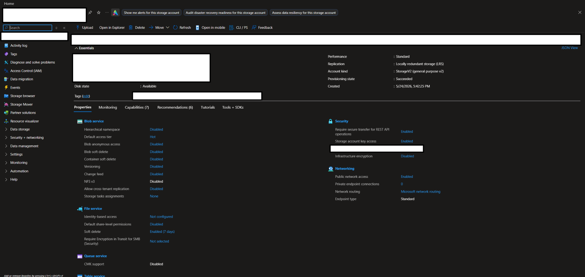
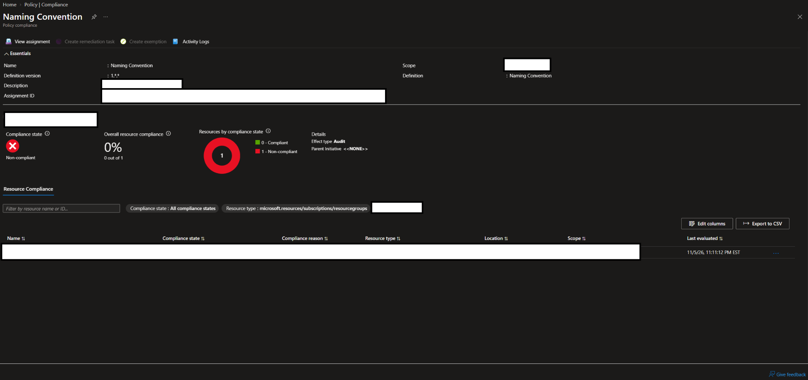
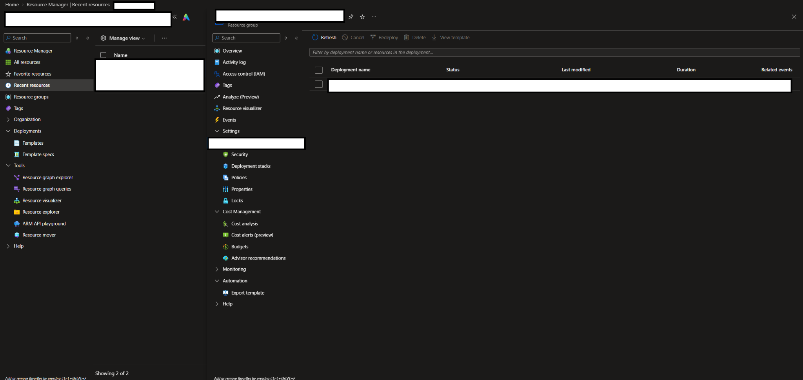
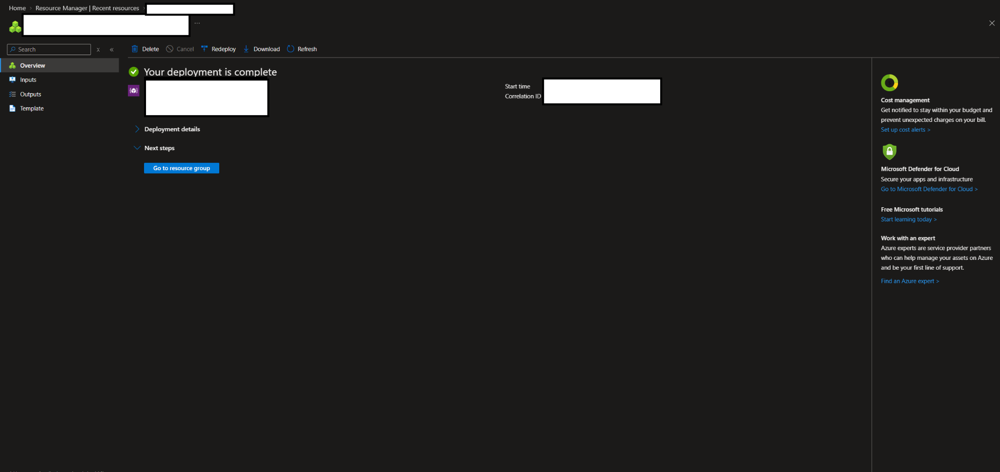

#  Operation Dead Deploy
### Investigating Unauthorized Resource Deployment in an Azure Subscription

##  Scenario

An intern was temporarily granted Contributor access to deploy a test environment in Microsoft Azure. Unfamiliar with the organization's governance requirements, the intern deployed resources that violated established naming standards and left for the weekend without correcting the issues.

As the on-call engineer the following Monday, I investigated using **Reader (read-only) access** to avoid modifying resources or disturbing potential evidence. My goal was to identify what had been provisioned, assess the risks, and determine why the existing naming policy had not prevented the deployment.

---

##  Environment

| Category | Details |
|---|---|
| **Platform** | Live multi-user Azure training tenant |
| **Services** | Azure Resource Manager (ARM) |
| **Tools** | Azure Portal, Resource Manager blades, Azure Policy |
| **Access** | Reader (read-only) |

---

##  Investigation

### 1. Locating the Offending Deployment

Our organization follows a strict naming convention:

`{resource-type}-{workload}-{environment}-{region}-{instance}`

During my review, I identified a resource group with a generic name that did not follow this structure. Because our naming standards make resources easier to identify and manage, this inconsistency stood out and warranted further investigation.

*Figure 1: Reviewing Azure resource groups to identify an inconsistent naming pattern.*

### 2. Investigating the Resource Group

I examined the resource group and its associated storage account, identifying several governance and security concerns.

**Resource tagging**

| Tag | Value | Concern |
|---|---|---|
| Owner | Intern's name | Identified the person associated with the deployment |
| Cost Center | `unspecified` | Made accurate cost allocation difficult |
| Environment | `unknown` | Left the resource's purpose and operational impact unclear |

Knowing the owner confirmed that it was the intern. An unknown Cost Center tag makes proper cost attribution difficult. An unknown environment classification also makes it harder to assess the consequences of modifying or removing a resource.

*Figure 2: Reviewing resource tags and their assigned values.*

**Storage account security**

My review also identified the following settings:

- **Minimum TLS version:** TLS 1.0, below the recommended minimum of TLS 1.2.
- **Network access:** Default network action set to `Allow`, without virtual network or IP restrictions.

The outdated TLS configuration and permissive network rules created unnecessary security exposure. 

*Figure 3: Reviewing the storage account's security and networking overview.*

### 3. Why Didn't Policy Stop This?

When reviewing the Azure Policy configuration, I found that the naming policy was assigned the **`Audit`** effect rather than **`Deny`**.

| Policy Effect | Behavior |
|---|---|
| `Audit` | Identifies noncompliance without blocking deployment |
| `Deny` | Blocks applicable operations that violate the policy |

This explained why the naming violation was not prevented: the policy could flag noncompliance, but it was not configured to block it.

*Figure 6: Azure Policy reports the Naming Convention assignment as noncompliant (0% compliance, one resource), with the effect set to `Audit` rather than `Deny`.*

*Figure 4: Reviewing deployment history for the affected resource group.*

*Figure 5: The Azure deployment overview confirms that the deployment completed successfully, regardless of the policy.*

> **Key finding:** A policy's existence does not guarantee enforcement. Its effect and scope determine whether it identifies or prevents violations.

---

##  What Broke / What Surprised Me

What surprised me most was the lack of noticeable alerts when noncompliant resources were deployed. This testing incident and similar oversights in testing/production could create serious financial and security risks.

Abandoned resources can generate unnecessary charges, especially when unclear tags make costs difficult to attribute. Insecure configurations can also expand the attack surface. Without regular monitoring, these issues could go unnoticed for an extended period.

---

## Findings and Recommendations

### Quick Fixes

- **Decommission unnecessary resources:** Obtain approval to shut down or remove the abandoned test environment.
- **Enforce naming policies:** Validate the policy's scope and impact, then change the effect from `Audit` to `Deny` where appropriate.
- **Update TLS:** Require TLS 1.2 or higher for the storage account.
- **Restrict network access:** Apply appropriate network restrictions.

### Follow-Up Remediation

- **Cost review:** Identify the deployment's charges and attribute them to the correct cost center.
- **Governance training:** Ensure users understand deployment requirements before receiving access.
- **Subscription security review:** Look for additional misconfigurations and opportunities to reduce the attack surface.
- **Compliance monitoring:** Configure alerts for critical policy violations.
- **Regional restrictions:** Consider allowing deployments only in approved Azure regions.
- **Tag validation:** Require meaningful tag values, not just the presence of tags.

Because I investigated with Reader permissions, remediation would require approval and action by authorized personnel. Changing a policy to `Deny` would not automatically fix existing resources.

---

##  What I Learned

This investigation showed how small configuration mistakes and weak policy enforcement can create financial, operational, and security risks. Effective cloud governance requires multiple layers of protection, including naming standards, meaningful tags, access controls, security baselines, and monitoring.

I also learned the importance of documenting each finding before moving on. Clear documentation helps prevent mistakes before deployment, supports thorough investigations, and provides a record of corrective actions to reduce repeat incidents.

Ultimately, **cloud security requires more than written policies: those policies must be correctly configured, enforced, and monitored.**

---

**Skills Demonstrated:** `Microsoft Azure` · `Azure Resource Manager` · `Azure Policy` · `Cloud Governance` · `Security Auditing` · `Incident Investigation` · `Risk Assessment` · `Technical Documentation`

*Investigation performed in a live Azure training environment using read-only permissions.*
