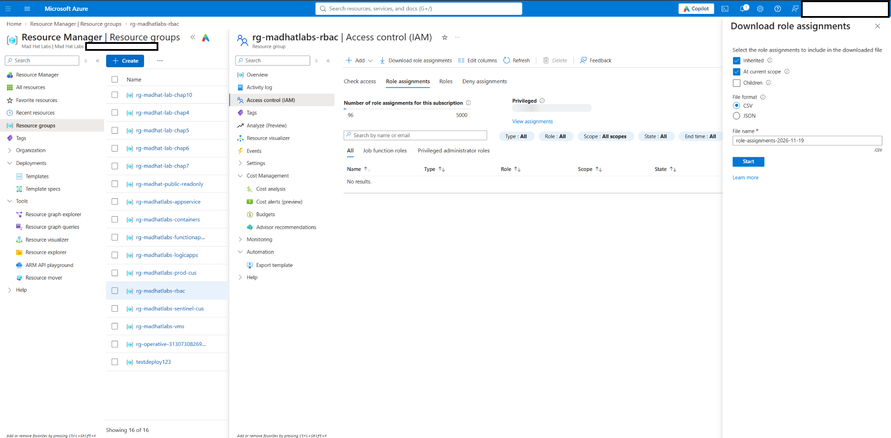
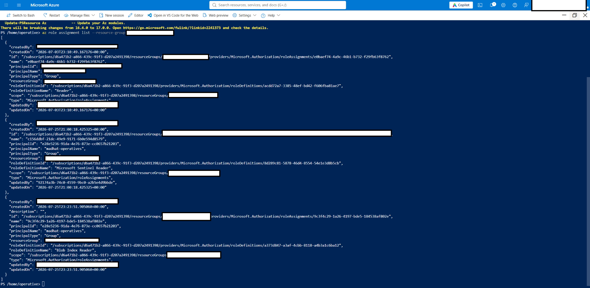
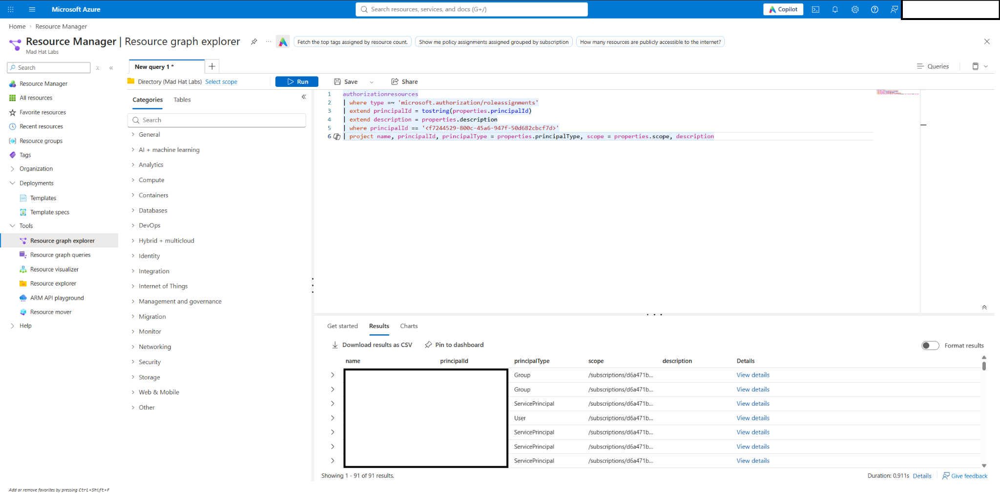
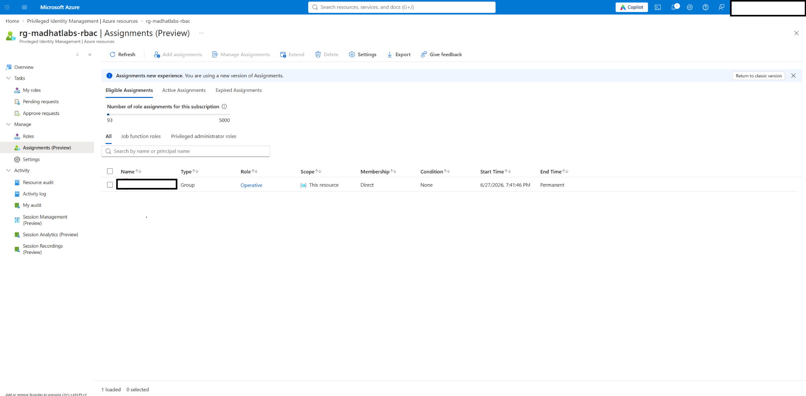
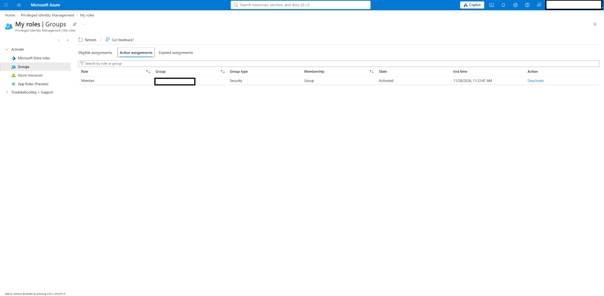
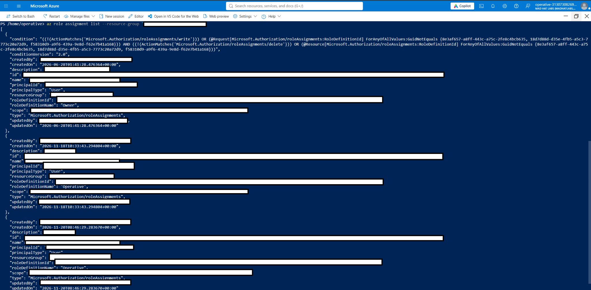

# The Privilege Audit
## Azure Identity and Access Management Investigation

## Scenario

This investigation focused on auditing privileged access in Microsoft Azure. My objective was to identify excessive permissions, orphaned role assignments, and privileged access that might be overlooked when relying on a single auditing method. I used the IAM blade and exports, Azure CLI, Azure Resource Graph with KQL, and Privileged Identity Management (PIM) to build a more complete picture of access across the environment.

## Environment and Tools

- **Platform:** Microsoft Azure / Microsoft Entra ID
- **Tools:** Access Control (IAM), Azure Cloud Shell, Azure CLI, Azure Resource Graph Explorer, KQL, Privileged Identity Management (PIM)
- **Focus:** Azure RBAC, role assignments, orphaned identities, eligible versus active privileges, and least privilege

## Investigation

### 1. IAM Blade — Reviewing Role Assignments

I started in **Access Control (IAM)** and utilized the **Download role assignments** feature, which can export assignments in CSV or JSON format. I reviewed the available role-assignment export and identified an account with redundant **Owner** assignments across multiple resources. Excessive Owner access increases the impact of a compromised identity and warrants review against the principle of least privilege.

The export provided a useful baseline, but it did not fully expose the members behind group assignments or reliably resolve every orphaned identity. Those gaps made additional auditing methods necessary.



### 2. Azure CLI — Investigating Orphaned Assignments

Next, I used **Azure Cloud Shell** to enumerate role assignments for a resource group:

```powershell
az role assignment list --resource-group <resource group>
```

The output showed role definitions, scopes, and principal IDs. Since my account could not resolve all the identity details needed for this finding, I cross-referenced a provided export representing the fuller results. That evidence helped me identify an orphaned assignment associated with a deleted identity whose role assignment had not been removed.

This illustrated why command-line enumeration and identity validation are important supplements to portal exports: a role assignment can remain even when its original principal no longer exists.



### 3. Azure Resource Graph — Tracing a Principal with KQL

I then used **Azure Resource Graph Explorer** to search role-assignment records across the Azure scopes available to the query. Using KQL, I filtered the `authorizationresources` table for the principal ID under investigation:

```kql
authorizationresources
| where type =~ 'microsoft.authorization/roleassignments'
| extend principalId = tostring(properties.principalId)
| extend description = properties.description
| where principalId == '<principal-ID>'
| project name, principalId, principalType = properties.principalType, scope = properties.scope, description
```

I located the principal ID through this method. Resource Graph made it possible to investigate assignments more broadly without opening each resource's IAM blade individually. It also demonstrated how KQL can help correlate access across scopes, although the results still depend on the permissions and scope of the query.



### 4. PIM — Comparing Eligible and Active Privileges

The earlier methods focused on role assignments, but they did not provide the full distinction between **active** access and privileges that an identity is **eligible to activate**. To investigate that difference, I opened **Privileged Identity Management (PIM)**, selected **Azure resources**, and navigated to the Mad Hat Labs subscription and `rg-madhatlabs-rbac` resource group.

From **Assignments**, I reviewed the eligible, active, and expired assignment views and exported the audit report. This provided additional identity information and helped identify the account of interest. PIM also offers a **Resource audit** view for examining privilege activation history—an important companion to assignment exports when determining who used elevated access and when.



### 5. The Hunt — Investigating Privileged Access

For the final investigation, I activated my eligible membership in the relevant security group through **PIM**. I then used Azure Cloud Shell to enumerate role assignments in the previously inaccessible resource group.



```powershell
az role assignment list --resource-group "<hidden group>"
```

I examined the returned role definitions, principal IDs, and scopes and identified the account holding an **Owner** assignment. This brought the investigation together: PIM exposed and enabled eligible access, while Azure CLI revealed the role assignment details needed to locate the over-provisioned account.



## Comparing the Auditing Methods

| Method | What It Reveals | Potential Blind Spots |
|---|---|---|
| **IAM blade / export** | Role assignments at a selected scope, including inherited access | Group membership and unresolved or orphaned identities may need separate review |
| **Azure CLI** | Detailed role assignments, principal IDs, scopes, and potentially unresolved names | Queries must be scoped appropriately; identity resolution depends on permissions |
| **Resource Graph (KQL)** | Broad searches and correlation of role assignments across accessible scopes | Does not provide a complete view of PIM-eligible assignments |
| **PIM export / Resource audit** | Eligible and active assignments; activation history through Resource audit | Must be supplemented with broader RBAC and identity reviews |

## Findings and Recommendations

- **Excessive Owner assignments:** Review redundant grants and reduce privileges to those required for each role.
- **Orphaned assignments:** Periodically reconcile role assignments with identities in Microsoft Entra ID and remove confirmed stale assignments.
- **Group-based access:** Audit privileged group membership, including changes that may indirectly expand access.
- **Eligible privileges:** Review PIM eligibility, activation requirements, and historical activation activity.
- **Incomplete visibility:** Correlate IAM exports, command-line results, Resource Graph queries, and PIM records rather than relying on a single report.

## What I Learned

This investigation showed me how easily important access details can fall into the blind spots between auditing tools. IAM exports established a baseline, Azure CLI helped examine individual assignments, Resource Graph made broader correlation possible, and PIM added visibility into eligible privileges and activation activity.

Most importantly, **the principle of least privilege and regular permission audits are critical** to maintaining a secure Azure environment. Identifying excessive access is only part of the job; organizations also need to validate who still requires that access, review how privileges are activated, and remove permissions that are no longer necessary.

## Skills Demonstrated

Azure RBAC · Identity and Access Management (IAM) · Azure CLI · Azure Cloud Shell · Azure Resource Graph · KQL · Privileged Identity Management (PIM) · Access Reviews · Least Privilege · Cloud Security Auditing
