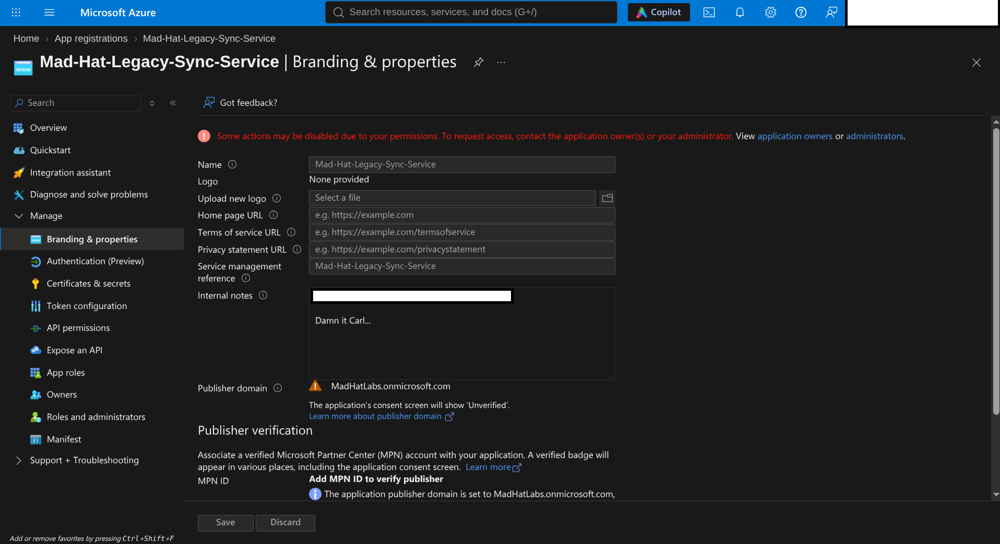
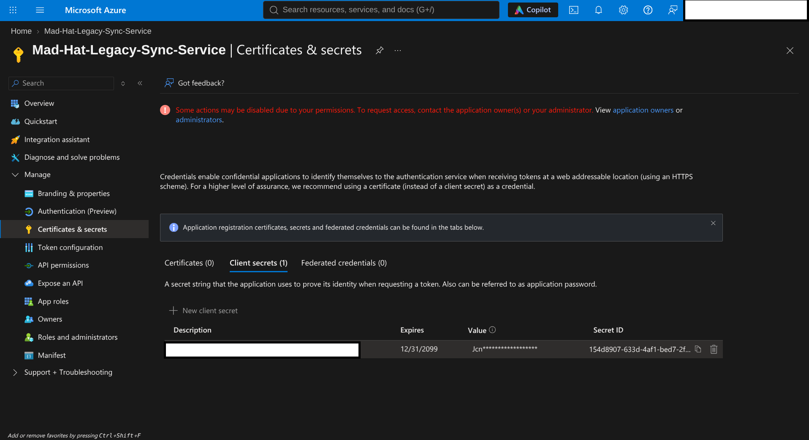
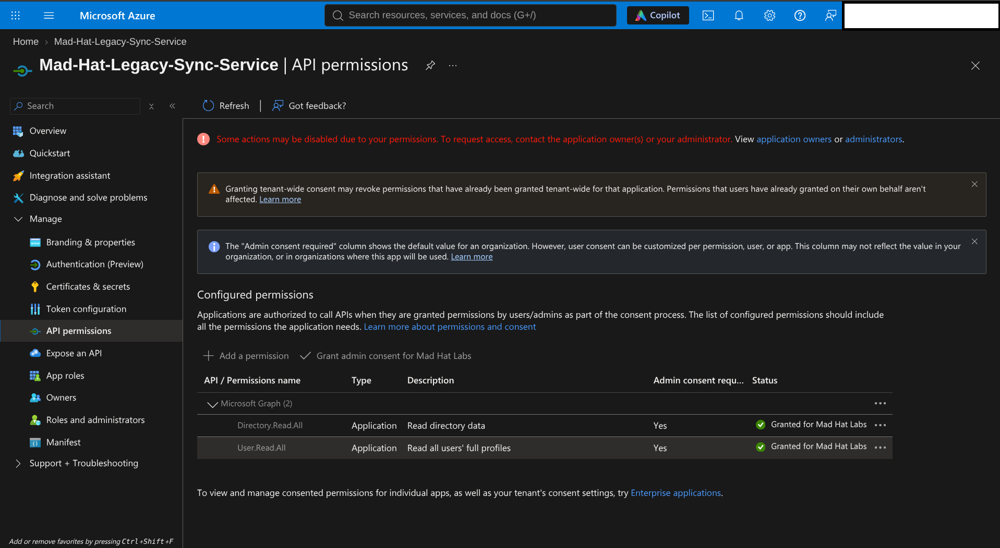
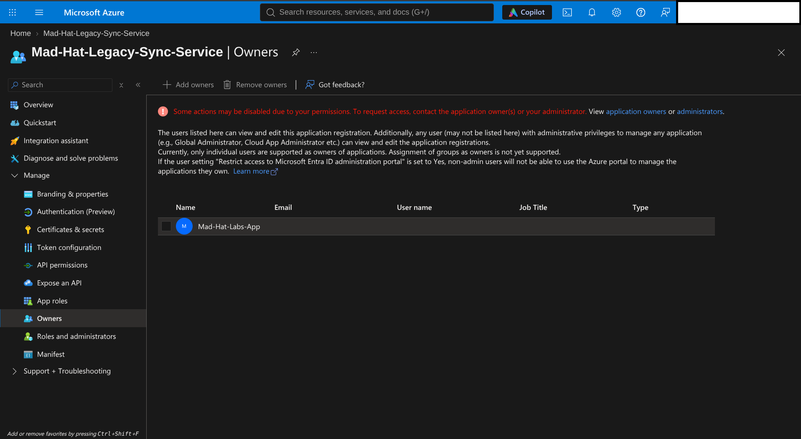
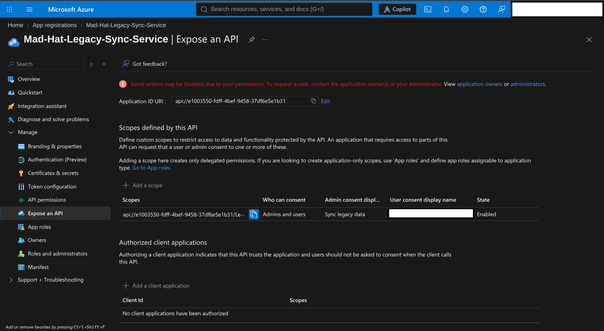
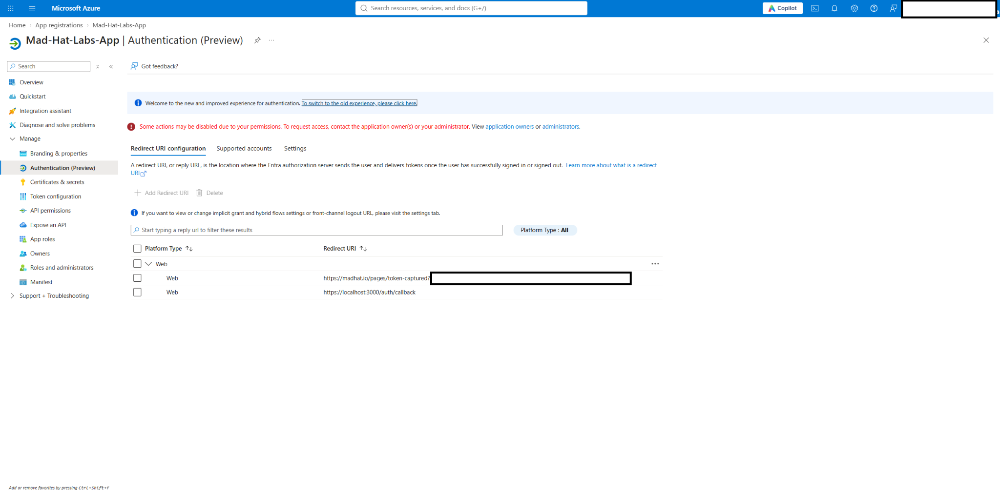

# The Stolen Identity

**Week 2 — Investigating an OAuth Consent-Phishing Attack in Microsoft Entra ID**

## Scenario

An attacker compromised an employee's authenticated session and exploited outdated application ownership permissions in Microsoft Entra ID. Using read-only access, I reconstructed a five-stage OAuth consent-phishing attack through forensic analysis of two linked app registrations.

My goal was to determine how the attacker moved from a compromised user session to application-based access, identify the weaknesses that made this possible, and recommend corrective actions.

## Environment

| Category | Details |
|---|---|
| Platform | Live, multi-user Microsoft Azure training tenant |
| Services | Microsoft Entra ID, App Registrations, Enterprise Applications |
| Tools | Azure Portal |
| Access | Read-only, to avoid changes to the environment or potential evidence |
| Focus | OAuth 2.0, phishing, persistence, application ownership, API permissions, identity security |

## Investigation

### 1. Entry — Initial Compromise

The attack began when an employee fell victim to phishing and completed an MFA challenge. The attacker obtained an authenticated session token that had already satisfied the Conditional Access requirements during sign-in.

During my investigation, I discovered that the compromised employee was still listed as an Owner of `Mad-Hat-Legacy-Sync-Service`, a legacy application. An internal note on the application's **Branding & properties** page, left by the incident response team, identified the compromised employee.

*Figure 1: Branding and properties for the legacy application, including an internal note referencing Carl.*

### 2. Escalate — Exploiting Application Ownership

Using the compromised employee's Owner permissions, the attacker created a new client secret for the legacy application. This allowed authentication as the application's service principal through the OAuth 2.0 client credentials flow, using its existing permissions without requiring further employee sign-ins.

The screenshot below shows the newly created secret, with an expiration date of **December 31, 2099**. This unusually long validity period is a significant warning sign, as the credential could remain in the shadows allowing persistence for roughly a lifetime. 

*Figure 2: The legacy application's client secret expires on **12/31/2099**, an unusually long lifetime and a significant warning sign.*

### 3. Pivot — Establishing an Additional Access Path

Knowing the client secret could eventually be discovered and revoked, I investigated whether the attacker had established another method of persistence. 

Reviewing the legacy application's **API permissions**, I found two broad Microsoft Graph application permissions, `Directory.Read.All` and `User.Read.All`, both with administrator consent. These permissions increased the potential impact of the compromise by allowing access to directory and user information for further pivoting and persistence. 

Since standard Microsoft Entra ID users can register applications by default when permitted by tenant settings, I checked for recent registrations and discovered a suspicious application named `Mad-Hat-Labs-App`.

I then reviewed the legacy application's Owners list and confirmed that the rogue application's service principal had been added. This gave the attacker another way to manage the legacy application and create replacement credentials, even if the original secret was revoked.

*Figure 3: The legacy application's administrator-consented Microsoft Graph application permissions: `Directory.Read.All` and `User.Read.All`.*

*Figure 4: `Mad-Hat-Labs-App` appears in the legacy application's Owners list.*

### 4. Persist — Creating an Additional Persistence Mechanism

Since credential rotation is a common incident response measure, I continued looking for other methods of maintaining access.

Under the legacy application's **Expose an API** configuration, I discovered a custom delegated permission scope named `Legacy.Sync`, associated with its Application ID URI. This allowed other applications to request delegated access to the legacy API, subject to authorization and consent.

**Why this matters:** Unlike traditional credential phishing, OAuth consent phishing targets permissions granted by an already authenticated user. Unauthorized `OAuth2PermissionGrant` records can survive password resets, session revocation, and MFA changes, requiring separate investigation and revocation. If a trusted backend improperly uses these permissions to perform privileged actions, it can create a **confused deputy** vulnerability.

*Figure 5: An enabled custom API scope on the legacy application, with consent available to administrators and users. No client applications are shown as preauthorized.*

### 5. Loot — OAuth Consent Phishing

With the custom API scope configured and the rogue application under the attacker's control, the next objective would likely be obtaining consent from legitimate users.

I found a redirect URI on the rogue application pointing to a suspicious location, potentially allowing the attacker to receive OAuth authorization codes.

Using the rogue application's client ID, redirect URI, and the legacy application's exposed API scope, the attacker could construct a phishing URL requesting user consent.

If approved and the authorization flow completed successfully, the rogue application could potentially exchange the authorization code for an access token, providing delegated access to the legacy API.

Although the configuration demonstrated a potential OAuth consent-phishing attack, it did not independently confirm that credentials had already been harvested. 

*Figure 6: The rogue application's web redirect URI configuration includes a suspicious token-capture endpoint.*

## What Broke / What Surprised Me

What surprised me most was how application ownership could provide a meaningful access path without the attacker needing a directory administrator role. Standard users are by default allowed to register applications unless the tenant restricts it. Combined with outdated owners and broad permissions, that creates risks a traditional privileged-user review would miss. 

I was also surprised by the client secret expiring in 2099. A credential with that lifetime is a clear reason to investigate further, especially when it appears alongside an unexpected application owner and a suspicious redirect URI. By default I would think it would have some alert or limit on this unusual behavior. 

## Findings and Recommendations

### Quick Fixes

- **Revoke the suspicious client secret** and investigate any other compromised application credentials.
- **Remove unauthorized ownership**, including the rogue application from the legacy application's Owners list.
- **Review and remove the unauthorized API scope**, after checking for legitimate dependencies.
- **Identify and explicitly revoke unauthorized OAuth consent grants** (`OAuth2PermissionGrant`); resetting the user's password is not enough.
- **Remove attacker-controlled redirect URIs** and investigate whether the rogue application should be disabled or deleted.
- **Review the legacy application's Microsoft Graph permissions** and remove access that is no longer needed.

### Follow-Up Remediation

- Restrict standard users' ability to register applications where it is not required.
- Audit app registration owners and service principals alongside privileged directory role assignments.
- Alert on new client secrets, owner changes, and redirect URI additions.
- Tighten application consent policies and regularly review existing grants.
- Apply least privilege to application permissions and include app-based persistence in incident-response procedures.

These are **recommendations**, not changes made during this investigation.

## What I Learned

This investigation taught me that securing a compromised user account does not necessarily eliminate an attacker's access. In Microsoft Entra ID, attackers can establish persistence through long-lived client secrets, unauthorized application ownership, and OAuth consent grants that may remain active even after passwords are reset or user sessions are revoked without any further entry of a password and/or MFA. 

What surprised me most was how easily these access paths could go unnoticed. An application can possess significant permissions without appearing in a traditional review of privileged user accounts. This demonstrated why securing user accounts alone is not enough and why application ownership, credentials, and permissions require the same level of scrutiny.

Ultimately, this investigation reinforced the importance of **least privilege, regularly auditing application permissions, reviewing default behavior, and examining the entire chain of access during an incident**. My biggest takeaway was that effective incident response requires identifying and removing every unauthorized credential, permission, and application relationship that could allow an attacker to maintain or regain access.

---

**Skills Demonstrated:** Microsoft Entra ID · OAuth 2.0 · Cloud Security · Identity and Access Management · Incident Investigation · Application Permissions · Persistence Analysis · Technical Documentation

*This investigation was conducted in a live, multi-user Microsoft Azure training environment using read-only permissions to prevent unintended changes to the environment or alteration of potential evidence.*
