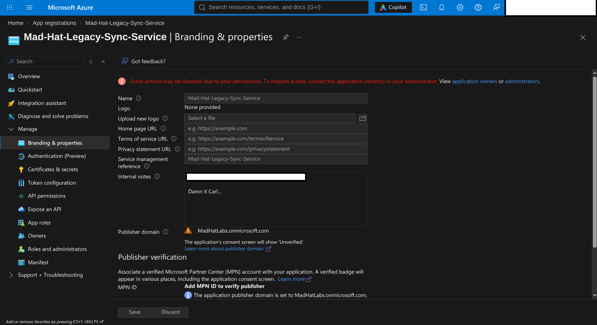
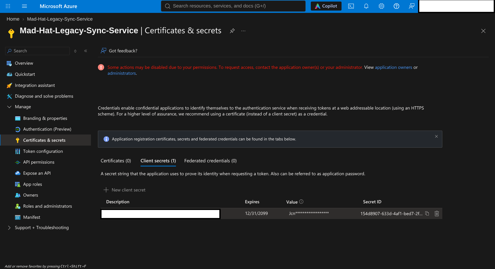
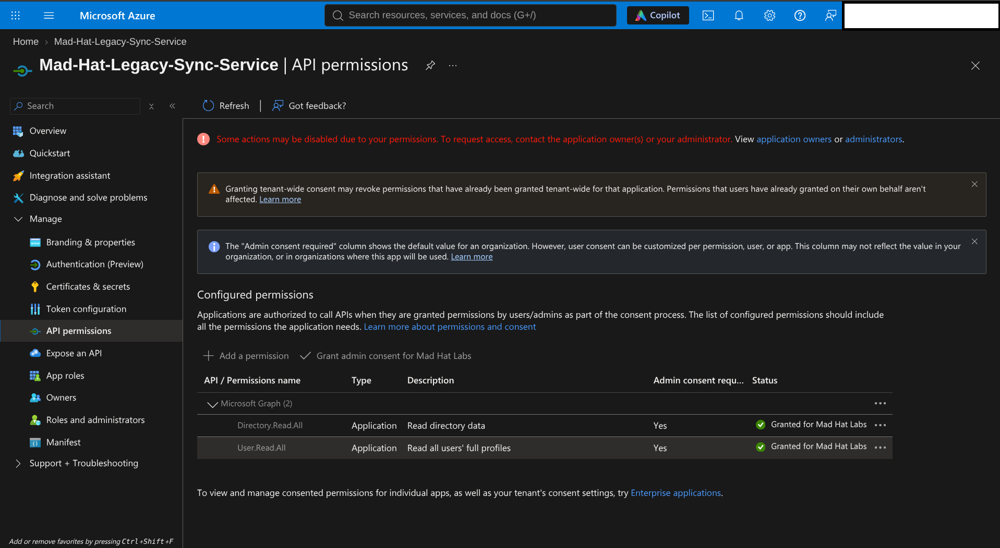
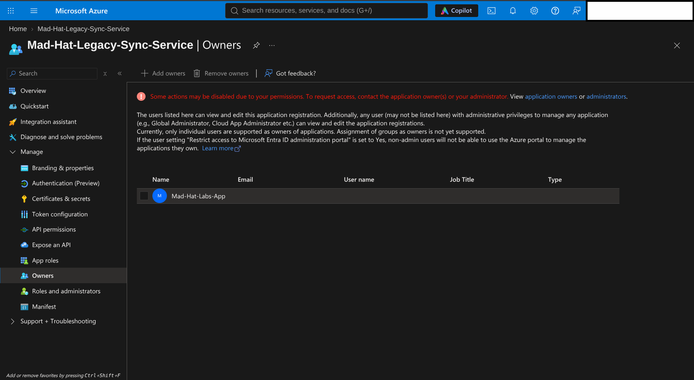
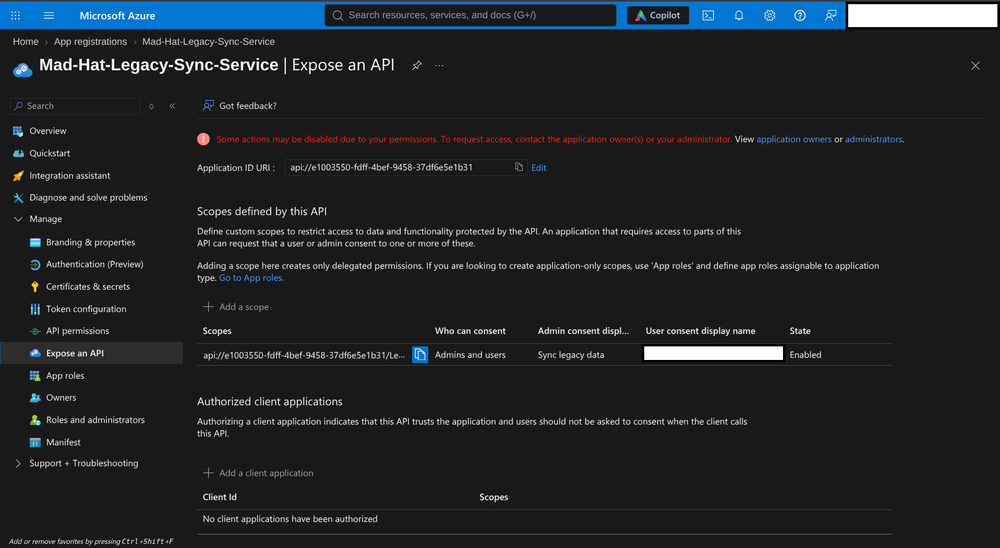
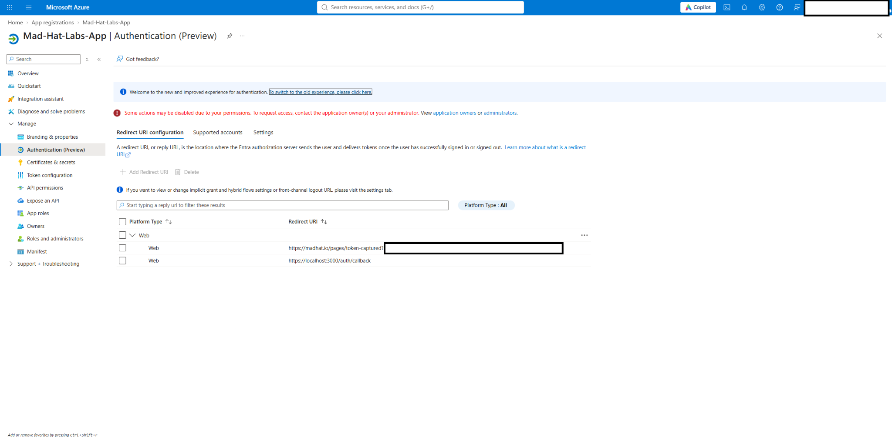

# The Stolen Identity

**Week 2 — Investigating an OAuth Consent-Phishing Attack in Microsoft Entra ID**

## Scenario

An attacker compromised an employee's authenticated session and exploited outdated application ownership permissions in Microsoft Entra ID. Using read-only access, I reconstructed a five-stage OAuth consent-phishing attack through forensic analysis of two linked app registrations.

My goal was to determine how the attacker moved from a compromised user session to application-based access, identify the weaknesses that made this possible, and recommend corrective actions.

## Environment

| Category | Details |
|---|---|
| Platform | Live, multi-user Microsoft Azure training tenant |
| Services | Microsoft Entra ID, App Registrations, Enterprise Applications |
| Tools | Azure Portal, Microsoft Entra admin center |
| Access | Read-only, to avoid changes to the environment or potential evidence |
| Focus | OAuth 2.0, application ownership, API permissions, identity security |

## Investigation

### 1. Entry — Initial Compromise

The attack began when Carl, an accounting employee, entered his credentials into a phishing site and completed multifactor authentication (MFA). The attacker obtained an authenticated session token with an MFA-satisfied claim. Depending on the Conditional Access controls in place, reusing that session could avoid another MFA prompt.

Carl also retained Owner access to the legacy `Mad-Hat-Legacy-Sync-Service` application after that access was no longer needed. This gave the attacker a route from the compromised user account into a trusted application. The application's internal notes reference Carl, although the screenshot alone does not establish how his session was stolen.

*Figure 1: Branding and properties for the legacy application, including an internal note referencing Carl.*

### 2. Escalate — Application Credentials

Using the compromised user's application ownership, the attacker created a client secret on the legacy application. A valid secret could allow the attacker to authenticate as the application through the OAuth 2.0 client credentials flow, without signing in again as Carl.

The credential's expiration date stood out immediately: **December 31, 2099**. That unusually distant date is suspicious because an overlooked secret could remain useful for years unless explicitly revoked.

*Figure 2: The legacy application's client secret expires on **12/31/2099**, an unusually long lifetime and a significant warning sign.*

### 3. Pivot — Application Permissions and Ownership

I reviewed the legacy application's Microsoft Graph permissions and found two administrator-consented **application** permissions: `Directory.Read.All` and `User.Read.All`. These allow access to directory data and user profile information, increasing the potential impact if the application's credentials are compromised.

The attacker also registered `Mad-Hat-Labs-App` and added it to the legacy application's Owners list. This created another way to control the legacy application and potentially issue replacement credentials if the first secret was revoked. Reviewing directory administrator roles alone would not necessarily reveal this ownership relationship.

*Figure 3: The legacy application's administrator-consented Microsoft Graph application permissions: `Directory.Read.All` and `User.Read.All`.*

*Figure 4: `Mad-Hat-Labs-App` appears in the legacy application's Owners list.*

### 4. Persist — Exposed API Scope

The legacy application's **Expose an API** page showed an enabled custom scope associated with legacy synchronization. This configuration allowed another application to request delegated permission to call the legacy API, providing a potential route for consent phishing.

The scope alone does not grant the rogue app the legacy application's Microsoft Graph application permissions. Any further abuse would depend on what the legacy API actually does with authorized requests.

*Figure 5: An enabled custom API scope on the legacy application, with consent available to administrators and users. No client applications are shown as preauthorized.*

### 5. Loot — OAuth Consent Phishing

The rogue application's Authentication page contained a suspicious web redirect URI pointing to a token-capture-themed endpoint, alongside a localhost callback. Combined with the rogue application's client ID and the legacy API scope, this could be used in an OAuth authorization request intended to obtain user consent.

A user already signed in on a trusted device might approve such a request without facing the same challenges as a fresh sign-in. If the authorization request succeeded, the authorization code could be sent to the configured redirect URI. The screenshot establishes the suspicious configuration, **not** that a victim consented or that a token was actually stolen.

*Figure 6: The rogue application's web redirect URI configuration includes a suspicious token-capture endpoint.*

**Why this matters:** Traditional credential phishing may be challenged by MFA, device compliance, or location-based policies. Consent phishing instead targets the authorization a user grants while already authenticated. An unauthorized `OAuth2PermissionGrant` can remain after a password reset, session revocation, or new MFA enforcement; it must be investigated and revoked separately. If a trusted backend uses that authorization to perform actions it should not allow, the result can be a **confused deputy** problem.

## What Broke / What Surprised Me

What surprised me most was how application ownership could provide a meaningful access path without the attacker needing a directory administrator role. Standard users may also be allowed to register applications unless the tenant restricts it. Combined with outdated owners and broad permissions, that creates risks a traditional privileged-user review could miss.

I was also struck by the client secret expiring in 2099. A credential with that lifetime is a clear reason to investigate further, especially when it appears alongside an unexpected application owner and a suspicious redirect URI.

## Findings and Recommendations

### Quick Fixes

- **Revoke the suspicious client secret** and investigate any other compromised application credentials.
- **Remove unauthorized ownership**, including the rogue application from the legacy application's Owners list.
- **Review and remove the unauthorized API scope**, after checking for legitimate dependencies.
- **Identify and explicitly revoke unauthorized OAuth consent grants** (`OAuth2PermissionGrant`); resetting the user's password is not enough.
- **Remove attacker-controlled redirect URIs** and investigate whether the rogue application should be disabled or deleted.
- **Review the legacy application's Microsoft Graph permissions** and remove access that is no longer needed.

### Follow-Up Remediation

- Restrict standard users' ability to register applications where it is not required.
- Audit app registration owners and service principals alongside privileged directory role assignments.
- Alert on new client secrets, owner changes, and redirect URI additions.
- Tighten application consent policies and regularly review existing grants.
- Apply least privilege to application permissions and include app-based persistence in incident-response procedures.

These are **recommendations**, not changes made during this investigation.

## What I Learned

This investigation taught me that securing a compromised user account does not necessarily eliminate an attacker's access. In Microsoft Entra ID, attackers can establish persistence through long-lived client secrets, unauthorized application ownership, and OAuth consent grants that may remain active even after passwords are reset or user sessions are revoked.

What surprised me most was how easily these access paths could go unnoticed. An application can possess significant permissions without appearing in a traditional review of privileged user accounts. This demonstrated why securing user accounts alone is not enough and why application ownership, credentials, and permissions require the same level of scrutiny.

Ultimately, this investigation reinforced the importance of **least privilege, regularly auditing application permissions, and examining the entire chain of access during an incident**. My biggest takeaway was that effective incident response requires identifying and removing every unauthorized credential, permission, and application relationship that could allow an attacker to maintain or regain access.

---

**Skills Demonstrated:** Microsoft Entra ID · OAuth 2.0 · Cloud Security · Identity and Access Management · Incident Investigation · Application Permissions · Persistence Analysis · Technical Documentation

*This investigation was conducted in a live, multi-user Microsoft Azure training environment using read-only permissions to prevent unintended changes to the environment or alteration of potential evidence.*
